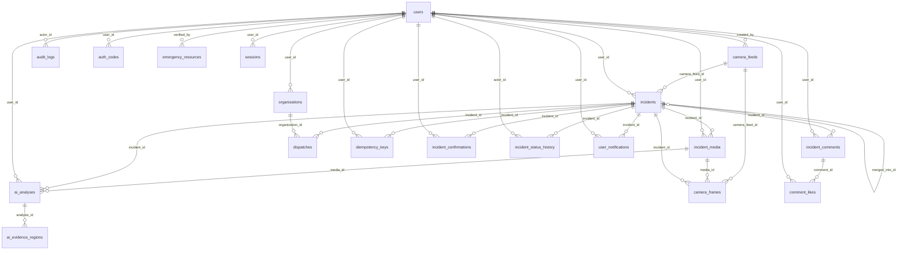

# Database

RescueLens uses MySQL 8 (MariaDB 10.11 also works). The schema is created by the Laravel migrations in `backend/database/migrations`. Two SQL files are provided:

* `backend/database/schema.sql`: structure only, exported from a fresh database built by the migrations.
* `backend/database/rescuelens.sql`: structure plus sanitized demo data. Only demo accounts are included, every password is the documented demo password, phones and tokens are removed, and incident coordinates are the public approximate ones.

Import steps are in [SETUP.md](SETUP.md#database).

## Entity relationships

## Tables

### ai_analyses

| Column | Type | Null |
|---|---|---|
| id | bigint(20) unsigned | no |
| public_id | char(26) | no |
| user_id | bigint(20) unsigned | no |
| media_id | bigint(20) unsigned | no |
| incident_id | bigint(20) unsigned | yes |
| mode | varchar(10) | no |
| provider | varchar(40) | no |
| vision_model | varchar(60) | yes |
| segmentation_model | varchar(60) | yes |
| status | varchar(20) | no |
| language | varchar(5) | no |
| primary_hazard | varchar(30) | yes |
| severity | varchar(12) | yes |
| requires_human_review | tinyint(1) | no |
| result | longtext | yes |
| error_code | varchar(40) | yes |
| latency_ms | int(10) unsigned | yes |
| created_at | timestamp | yes |
| updated_at | timestamp | yes |

### ai_evidence_regions

| Column | Type | Null |
|---|---|---|
| id | bigint(20) unsigned | no |
| analysis_id | bigint(20) unsigned | no |
| label | varchar(80) | no |
| source | varchar(20) | no |
| x1 | int(10) unsigned | no |
| y1 | int(10) unsigned | no |
| x2 | int(10) unsigned | no |
| y2 | int(10) unsigned | no |
| image_width | int(10) unsigned | no |
| image_height | int(10) unsigned | no |
| confidence | decimal(5 | yes |
| created_at | timestamp | yes |
| updated_at | timestamp | yes |

### audit_logs

| Column | Type | Null |
|---|---|---|
| id | bigint(20) unsigned | no |
| actor_id | bigint(20) unsigned | yes |
| action | varchar(60) | no |
| subject_type | varchar(60) | yes |
| subject_id | bigint(20) unsigned | yes |
| ip_hash | char(64) | yes |
| meta | longtext | yes |
| created_at | timestamp | no |

### auth_codes

| Column | Type | Null |
|---|---|---|
| id | bigint(20) unsigned | no |
| user_id | bigint(20) unsigned | no |
| purpose | varchar(20) | no |
| token_hash | varchar(64) | yes |
| code_hash | varchar(64) | no |
| attempts | tinyint(3) unsigned | no |
| expires_at | timestamp | no |
| used_at | timestamp | yes |
| created_at | timestamp | yes |
| updated_at | timestamp | yes |

### cache

| Column | Type | Null |
|---|---|---|
| key | varchar(255) | no |
| value | mediumtext | no |
| expiration | bigint(20) | no |

### cache_locks

| Column | Type | Null |
|---|---|---|
| key | varchar(255) | no |
| owner | varchar(255) | no |
| expiration | bigint(20) | no |

### camera_feeds

| Column | Type | Null |
|---|---|---|
| id | bigint(20) unsigned | no |
| public_id | char(26) | no |
| name | varchar(120) | no |
| kind | varchar(20) | no |
| snapshot_url | varchar(500) | yes |
| lat | decimal(9 | no |
| lng | decimal(9 | no |
| area_name | varchar(120) | yes |
| country_code | char(2) | no |
| interval_seconds | int(10) unsigned | no |
| is_active | tinyint(1) | no |
| last_polled_at | timestamp | yes |
| last_error | varchar(120) | yes |
| created_by | bigint(20) unsigned | no |
| created_at | timestamp | yes |
| updated_at | timestamp | yes |
| deleted_at | timestamp | yes |

### camera_frames

| Column | Type | Null |
|---|---|---|
| id | bigint(20) unsigned | no |
| camera_feed_id | bigint(20) unsigned | no |
| media_id | bigint(20) unsigned | yes |
| status | varchar(20) | no |
| incident_id | bigint(20) unsigned | yes |
| error | varchar(120) | yes |
| created_at | timestamp | yes |
| updated_at | timestamp | yes |

### comment_likes

| Column | Type | Null |
|---|---|---|
| id | bigint(20) unsigned | no |
| comment_id | bigint(20) unsigned | no |
| user_id | bigint(20) unsigned | no |
| created_at | timestamp | yes |
| updated_at | timestamp | yes |

### content_translations

| Column | Type | Null |
|---|---|---|
| id | bigint(20) unsigned | no |
| subject_type | varchar(20) | no |
| subject_id | bigint(20) unsigned | no |
| field | varchar(20) | no |
| locale | varchar(8) | no |
| source_lang | varchar(8) | yes |
| source_hash | varchar(40) | no |
| text | text | no |
| created_at | timestamp | yes |
| updated_at | timestamp | yes |

### dispatches

| Column | Type | Null |
|---|---|---|
| id | bigint(20) unsigned | no |
| incident_id | bigint(20) unsigned | no |
| organization_id | bigint(20) unsigned | no |
| status | varchar(20) | no |
| distance_km | decimal(7 | no |
| reason | varchar(200) | yes |
| created_at | timestamp | yes |
| updated_at | timestamp | yes |

### emergency_resources

| Column | Type | Null |
|---|---|---|
| id | bigint(20) unsigned | no |
| name | varchar(160) | no |
| name_bn | varchar(160) | yes |
| category | varchar(30) | no |
| phone | varchar(30) | yes |
| jurisdiction | varchar(120) | no |
| source_name | varchar(160) | no |
| source_url | varchar(500) | no |
| verified_at | timestamp | yes |
| last_reviewed_at | timestamp | yes |
| verified_by | bigint(20) unsigned | yes |
| is_active | tinyint(1) | no |
| created_at | timestamp | yes |
| updated_at | timestamp | yes |
| country_code | char(2) | no |
| deleted_at | timestamp | yes |

### failed_jobs

| Column | Type | Null |
|---|---|---|
| id | bigint(20) unsigned | no |
| uuid | varchar(255) | no |
| connection | varchar(255) | no |
| queue | varchar(255) | no |
| payload | longtext | no |
| exception | longtext | no |
| failed_at | timestamp | no |

### idempotency_keys

| Column | Type | Null |
|---|---|---|
| id | bigint(20) unsigned | no |
| user_id | bigint(20) unsigned | no |
| key | varchar(80) | no |
| incident_id | bigint(20) unsigned | yes |
| created_at | timestamp | yes |
| updated_at | timestamp | yes |

### incident_comments

| Column | Type | Null |
|---|---|---|
| id | bigint(20) unsigned | no |
| incident_id | bigint(20) unsigned | no |
| user_id | bigint(20) unsigned | no |
| body | text | no |
| created_at | timestamp | yes |
| updated_at | timestamp | yes |
| deleted_at | timestamp | yes |
| source_lang | varchar(8) | yes |
| parent_id | bigint(20) unsigned | yes |
| edited_at | timestamp | yes |
| likes_count | int(10) unsigned | no |

### incident_confirmations

| Column | Type | Null |
|---|---|---|
| id | bigint(20) unsigned | no |
| incident_id | bigint(20) unsigned | no |
| user_id | bigint(20) unsigned | no |
| type | varchar(10) | no |
| created_at | timestamp | yes |
| updated_at | timestamp | yes |

### incident_media

| Column | Type | Null |
|---|---|---|
| id | bigint(20) unsigned | no |
| public_id | char(26) | no |
| user_id | bigint(20) unsigned | no |
| incident_id | bigint(20) unsigned | yes |
| disk | varchar(20) | no |
| path | varchar(255) | no |
| video_path | varchar(255) | yes |
| video_seconds | int(10) unsigned | yes |
| thumb_path | varchar(255) | yes |
| mime | varchar(40) | no |
| width | int(10) unsigned | no |
| height | int(10) unsigned | no |
| size_bytes | int(10) unsigned | no |
| sha256 | char(64) | no |
| metadata_stripped | tinyint(1) | no |
| created_at | timestamp | yes |
| updated_at | timestamp | yes |

### incident_status_history

| Column | Type | Null |
|---|---|---|
| id | bigint(20) unsigned | no |
| incident_id | bigint(20) unsigned | no |
| actor_id | bigint(20) unsigned | yes |
| from_status | varchar(20) | yes |
| to_status | varchar(20) | no |
| note | varchar(500) | yes |
| created_at | timestamp | yes |
| updated_at | timestamp | yes |

### incidents

| Column | Type | Null |
|---|---|---|
| id | bigint(20) unsigned | no |
| public_id | char(26) | no |
| user_id | bigint(20) unsigned | no |
| title | varchar(160) | no |
| description | text | yes |
| category | varchar(30) | no |
| severity | varchar(12) | no |
| status | varchar(20) | no |
| lat | decimal(9 | no |
| lng | decimal(9 | no |
| public_lat | decimal(9 | no |
| public_lng | decimal(9 | no |
| area_name | varchar(120) | yes |
| address | varchar(300) | yes |
| is_anonymous | tinyint(1) | no |
| is_demo | tinyint(1) | no |
| ai_assisted | tinyint(1) | no |
| merged_into_id | bigint(20) unsigned | yes |
| confirmations_count | int(10) unsigned | no |
| disputes_count | int(10) unsigned | no |
| comments_count | int(10) unsigned | no |
| occurred_at | timestamp | yes |
| verified_at | timestamp | yes |
| created_at | timestamp | yes |
| updated_at | timestamp | yes |
| source | varchar(20) | no |
| ai_unverified | tinyint(1) | no |
| ai_confidence | decimal(4 | yes |
| feed_eligible | tinyint(1) | no |
| camera_feed_id | bigint(20) unsigned | yes |
| deleted_at | timestamp | yes |
| severity_confidence | double | yes |
| severity_reasons | longtext | yes |
| severity_source | varchar(12) | no |
| recommended_responders | longtext | yes |
| alert_radius_km | smallint(5) unsigned | yes |
| source_lang | varchar(8) | yes |
| edited_at | timestamp | yes |
| deleted_by | bigint(20) unsigned | yes |

### job_batches

| Column | Type | Null |
|---|---|---|
| id | varchar(255) | no |
| name | varchar(255) | no |
| total_jobs | int(11) | no |
| pending_jobs | int(11) | no |
| failed_jobs | int(11) | no |
| failed_job_ids | longtext | no |
| options | mediumtext | yes |
| cancelled_at | int(11) | yes |
| created_at | int(11) | no |
| finished_at | int(11) | yes |

### jobs

| Column | Type | Null |
|---|---|---|
| id | bigint(20) unsigned | no |
| queue | varchar(255) | no |
| payload | longtext | no |
| attempts | smallint(5) unsigned | no |
| reserved_at | int(10) unsigned | yes |
| available_at | int(10) unsigned | no |
| created_at | int(10) unsigned | no |

### languages

| Column | Type | Null |
|---|---|---|
| id | bigint(20) unsigned | no |
| code | varchar(12) | no |
| native_name | varchar(80) | no |
| english_name | varchar(80) | no |
| rtl | tinyint(1) | no |
| enabled | tinyint(1) | no |
| hand_translated | tinyint(1) | no |
| sort | smallint(5) unsigned | no |
| created_at | timestamp | yes |
| updated_at | timestamp | yes |
| deleted_at | timestamp | yes |

### migrations

| Column | Type | Null |
|---|---|---|
| id | int(10) unsigned | no |
| migration | varchar(255) | no |
| batch | int(11) | no |

### organizations

| Column | Type | Null |
|---|---|---|
| id | bigint(20) unsigned | no |
| public_id | varchar(26) | no |
| user_id | bigint(20) unsigned | yes |
| type | varchar(20) | no |
| name | varchar(160) | no |
| phone | varchar(30) | no |
| lat | decimal(10 | no |
| lng | decimal(10 | no |
| address | varchar(300) | yes |
| country_code | varchar(2) | yes |
| coverage_km | smallint(5) unsigned | no |
| service_hours | varchar(80) | yes |
| verified_at | timestamp | yes |
| is_demo | tinyint(1) | no |
| created_at | timestamp | yes |
| updated_at | timestamp | yes |
| deleted_at | timestamp | yes |

### password_reset_tokens

| Column | Type | Null |
|---|---|---|
| email | varchar(255) | no |
| token | varchar(255) | no |
| created_at | timestamp | yes |

### personal_access_tokens

| Column | Type | Null |
|---|---|---|
| id | bigint(20) unsigned | no |
| tokenable_type | varchar(255) | no |
| tokenable_id | bigint(20) unsigned | no |
| name | text | no |
| token | varchar(64) | no |
| abilities | text | yes |
| last_used_at | timestamp | yes |
| expires_at | timestamp | yes |
| created_at | timestamp | yes |
| updated_at | timestamp | yes |

### sessions

| Column | Type | Null |
|---|---|---|
| id | varchar(255) | no |
| user_id | bigint(20) unsigned | yes |
| ip_address | varchar(45) | yes |
| user_agent | text | yes |
| payload | longtext | no |
| last_activity | int(11) | no |

### settings

| Column | Type | Null |
|---|---|---|
| id | bigint(20) unsigned | no |
| key | varchar(80) | no |
| value | text | yes |
| is_secret | tinyint(1) | no |
| created_at | timestamp | yes |
| updated_at | timestamp | yes |

### ui_translations

| Column | Type | Null |
|---|---|---|
| id | bigint(20) unsigned | no |
| lang | varchar(12) | no |
| key | varchar(120) | no |
| source_hash | char(40) | no |
| value | text | no |
| provider | varchar(60) | no |
| created_at | timestamp | yes |
| updated_at | timestamp | yes |

### user_notifications

| Column | Type | Null |
|---|---|---|
| id | bigint(20) unsigned | no |
| user_id | bigint(20) unsigned | no |
| incident_id | bigint(20) unsigned | yes |
| type | varchar(30) | no |
| title | varchar(200) | no |
| body | varchar(500) | yes |
| read_at | timestamp | yes |
| created_at | timestamp | yes |
| updated_at | timestamp | yes |

### users

| Column | Type | Null |
|---|---|---|
| id | bigint(20) unsigned | no |
| public_id | char(26) | yes |
| name | varchar(255) | no |
| email | varchar(255) | no |
| email_verified_at | timestamp | yes |
| password | varchar(255) | no |
| role | varchar(20) | no |
| account_type | varchar(20) | no |
| locale | varchar(10) | no |
| remember_token | varchar(100) | yes |
| created_at | timestamp | yes |
| updated_at | timestamp | yes |
| alert_lat | decimal(9 | yes |
| alert_lng | decimal(9 | yes |
| alert_radius_km | smallint(5) unsigned | no |
| ai_consent | tinyint(1) | no |
| is_demo | tinyint(1) | no |
| country_code | char(2) | no |
| distance_unit | varchar(2) | no |
| timezone | varchar(64) | yes |
| auto_post_enabled | tinyint(1) | no |
| auto_post_consent_at | timestamp | yes |
| deleted_at | timestamp | yes |
| notify_prefs | longtext | yes |
| theme | varchar(10) | no |
| avatar_path | varchar(255) | yes |
| phone | varchar(32) | yes |
| bio | varchar(200) | yes |

Framework tables (cache, jobs, sessions, tokens) are created by Laravel and are excluded from the demo data file.
