# Judging Guide

A 10 minute walkthrough of RescueLens, mapped to the judging criteria. Start the app first with the [Quick Start](../README.md#quick-start-for-judges-5-minutes). All demo accounts use the password `RescueLensDemo2026!`.

## 1. Meta AI usage

| What to try | Where | Expected result | Screenshot |
|---|---|---|---|
| Report an incident from a photo | Sign in as rina@rescuelens.test, open **Report**, add a photo | Meta AI drafts the type, severity, hazards and a short description. You confirm or edit before it is posted. Without a key the draft is labeled DEMO | 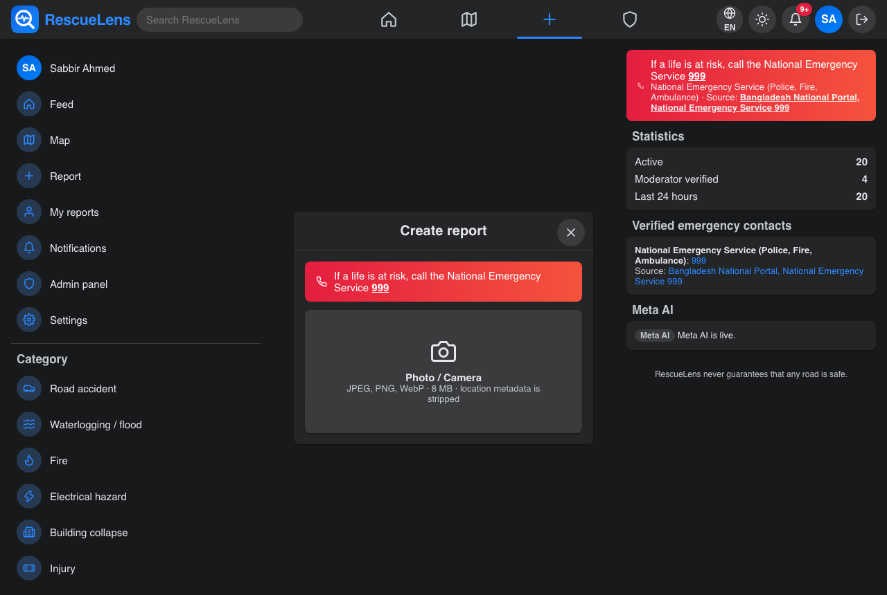 |
| See the AI analysis on a post | Open any incident from **Feed** | Incident detail shows the AI summary, hazards and confidence. It never says a road is safe | 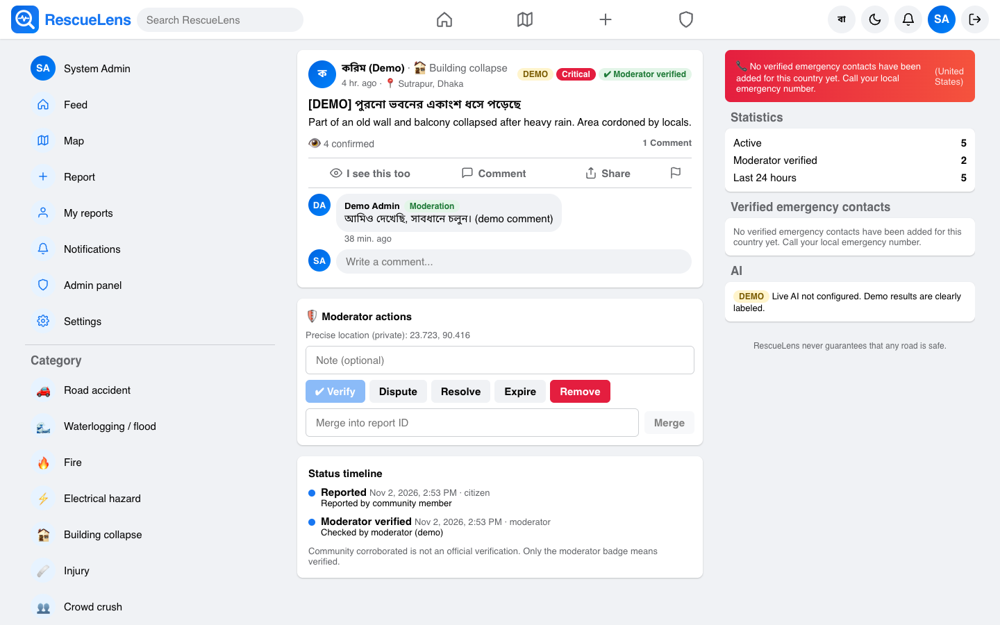 |
| Translate a post | **Feed**, tap translate on a post | Meta AI translates the post into your chosen language | 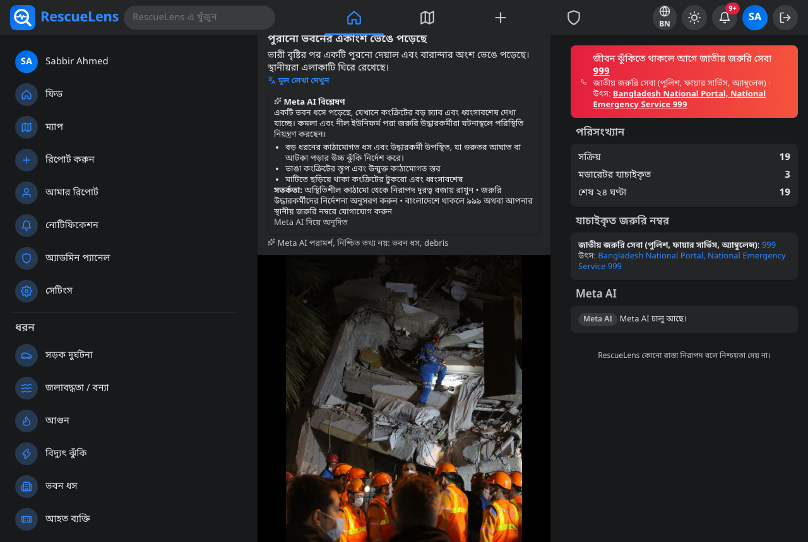 |
| Use another language | **Settings**, change language (Bangla, Arabic and more) | The whole interface switches, with right to left layout for Arabic | 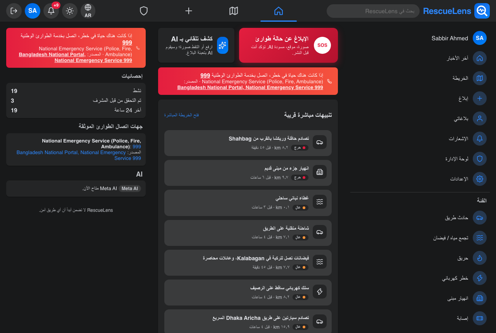 |

### Meta AI code

| File | Role |
|---|---|
| `backend/app/Services/AnalysisPipeline.php` | Orchestrates image processing, analysis, validation and storage |
| `backend/app/Services/ImageProcessor.php` | Strips metadata and resizes images before analysis |
| `backend/app/Services/AI/MetaModelClient.php` | HTTP client for the Meta model API |
| `backend/app/Services/AI/MetaVisionProvider.php` | Image understanding with Meta vision models |
| `backend/app/Services/AI/MetaSamProvider.php` | Segmentation with Meta SAM |
| `backend/app/Services/AI/Llama/LlamaVisionProvider.php`, `LlamaTextTranslator.php`, `OpenAiCompatClient.php` | Llama API integration |
| `backend/app/Services/AI/AnalysisSchema.php`, `AnalysisValidator.php` | Strict JSON schema and safety validation of model output |
| `backend/app/Services/AI/DemoVisionProvider.php` | Labeled demo fallback when no key is set |
| `backend/app/Services/I18n/MetaTextTranslator.php`, `TranslationService.php` | Post and interface translation |
| `backend/app/Providers/AppServiceProvider.php`, `backend/config/rescuelens.php` | Provider selection and settings |
| `backend/tests/` (`MetaProviderTest`) | Tests for the Meta providers |

More detail: [AI_PIPELINE.md](AI_PIPELINE.md).

## 2. Impact

| What to try | Where | Expected result | Screenshot |
|---|---|---|---|
| Live incident map | **Map** | Incidents shown with type icons, heatmap and nearby view. Locations are shown at a public, rounded position to protect reporters | 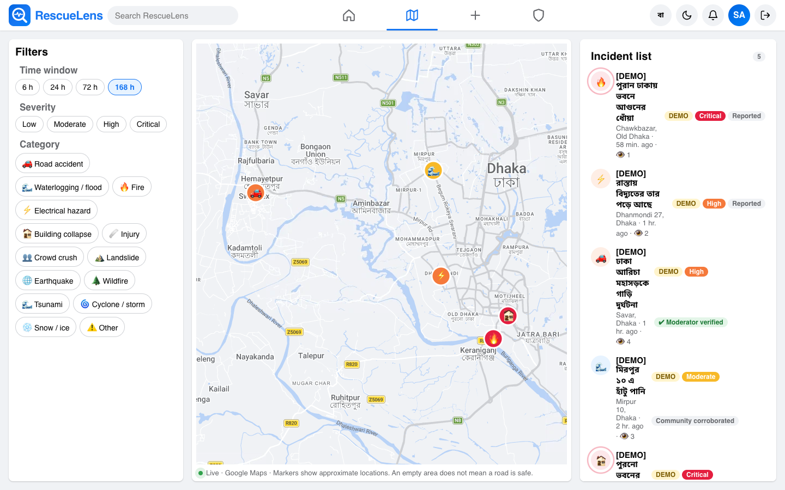 |
| Nearby help and emergency numbers | Incident detail or **Map**, nearby help | Only verified emergency numbers, each with its source | 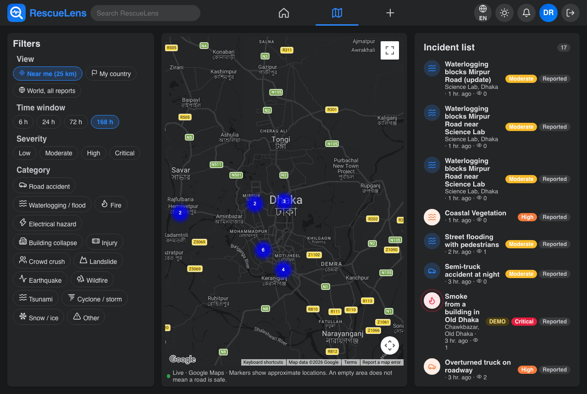 |
| Alerts to responders | Sign in as fire@rescuelens.test or ambulance@rescuelens.test | Responder portal lists incidents dispatched to that service | 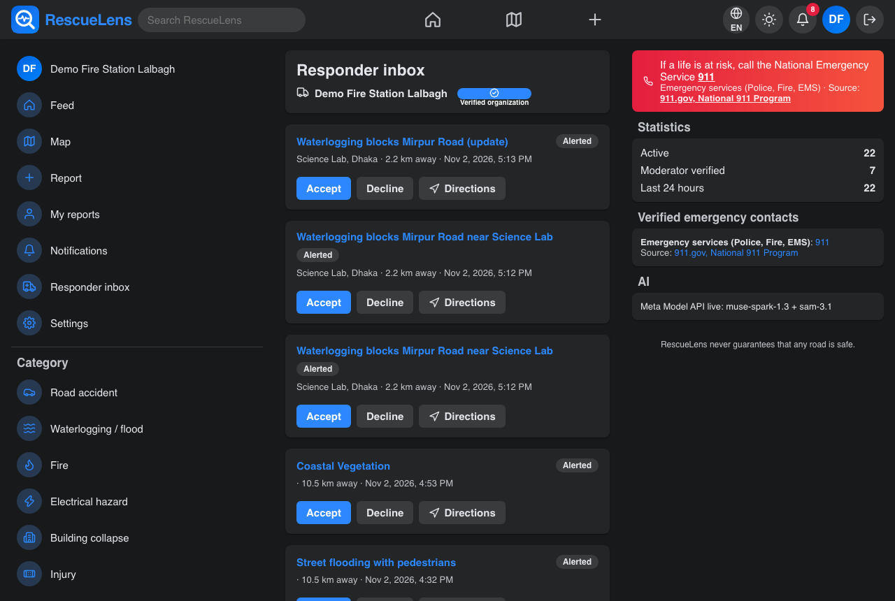 |
| Community confirmation | Sign in as karim@rescuelens.test, open Rina's report | "I see this too" raises confidence in a report | 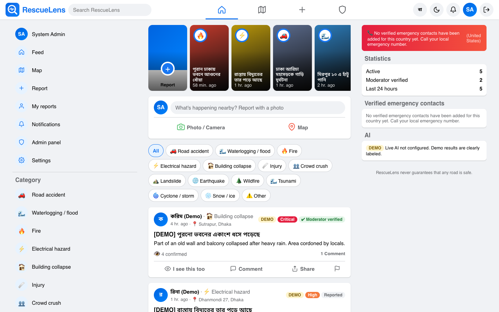 |

## 3. Technical depth

* Laravel 13 API with Sanctum auth, role based access (the role field is not user writable) and audit logging.
* Image privacy: EXIF stripped, precise reporter location never exposed.
* Strict schema validation of every AI response, with a safe fallback.
* React 19 PWA, Flutter app for Android and iOS, shared REST API.
* Tests: `cd backend && php artisan test`.
* Database: [DATABASE.md](DATABASE.md). Load test: `scripts/loadtest.sh`.

## 4. UX

| What to try | Where | Expected result | Screenshot |
|---|---|---|---|
| Moderation | moderator@rescuelens.test, **Moderation** | Verify, dispute or resolve reports | 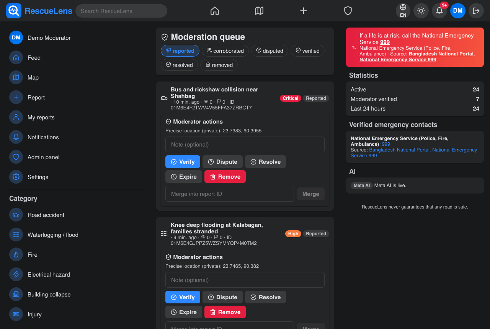 |
| Admin | admin@rescuelens.test, **Admin** | Manage users, organizations and emergency contacts | 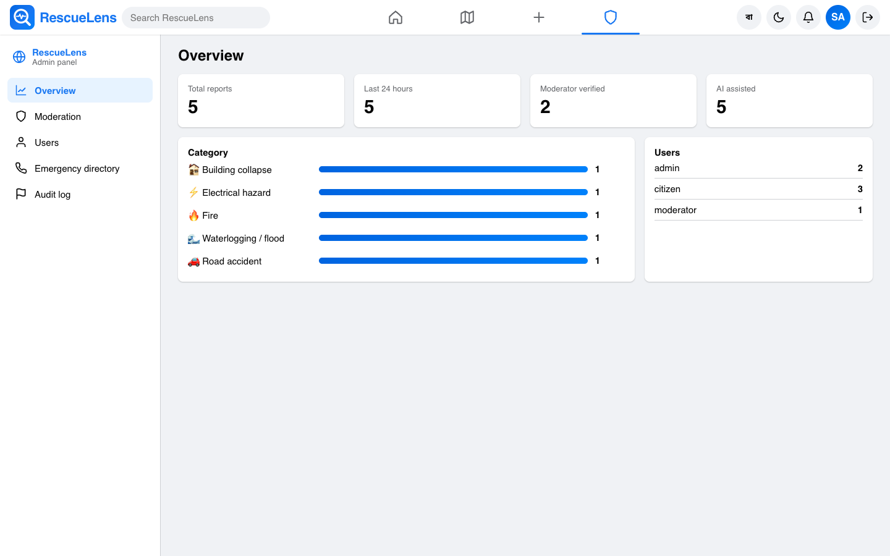 |
| Notifications | Bell icon | Alerts for nearby incidents and updates | 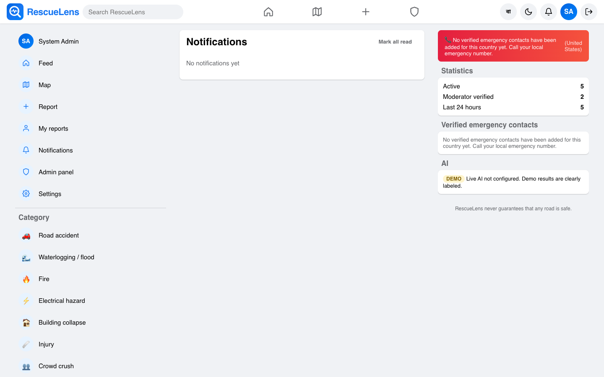 |
| Dark mode and Bangla | Default theme is dark | Clean dark interface | 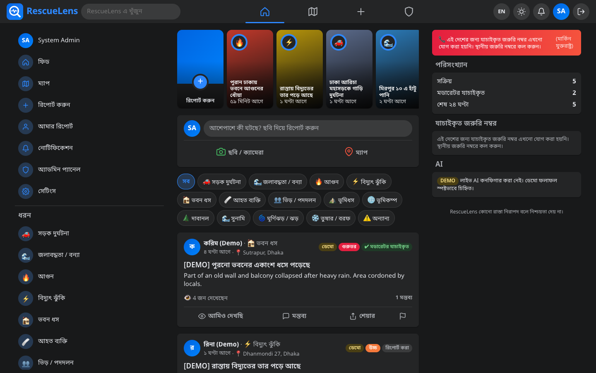 |

## 5. Completeness

* Web, API and mobile app all working against one backend.
* Ten demo accounts across all portals ([DEMO_ACCESS.md](DEMO_ACCESS.md)).
* One command start with Docker, or setup scripts without Docker ([SETUP.md](SETUP.md)).
* Android APK on the [Releases page](https://github.com/zenderfox20904/RescueLens/releases/latest), iOS steps in [MOBILE_APP.md](MOBILE_APP.md).
* Requirements traceability: [REQUIREMENTS_TRACEABILITY.md](REQUIREMENTS_TRACEABILITY.md).
* Demo video: see the README.
